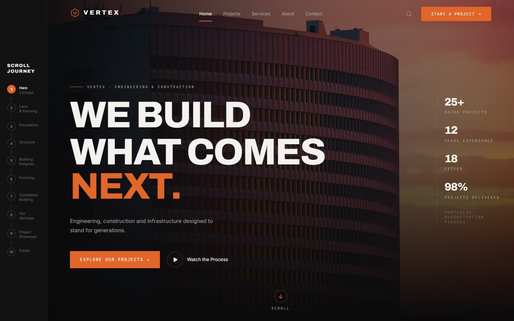
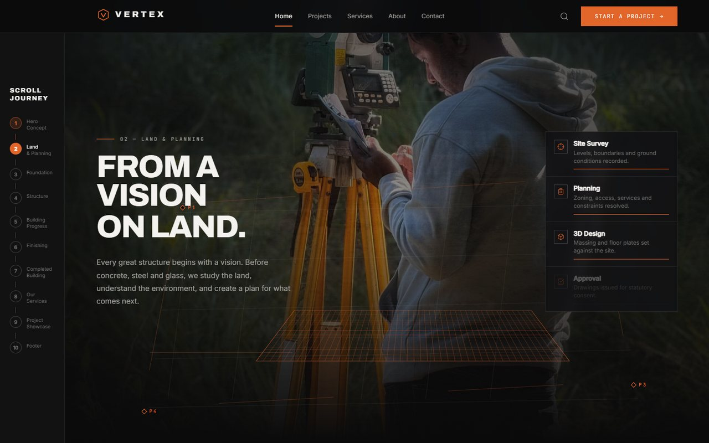
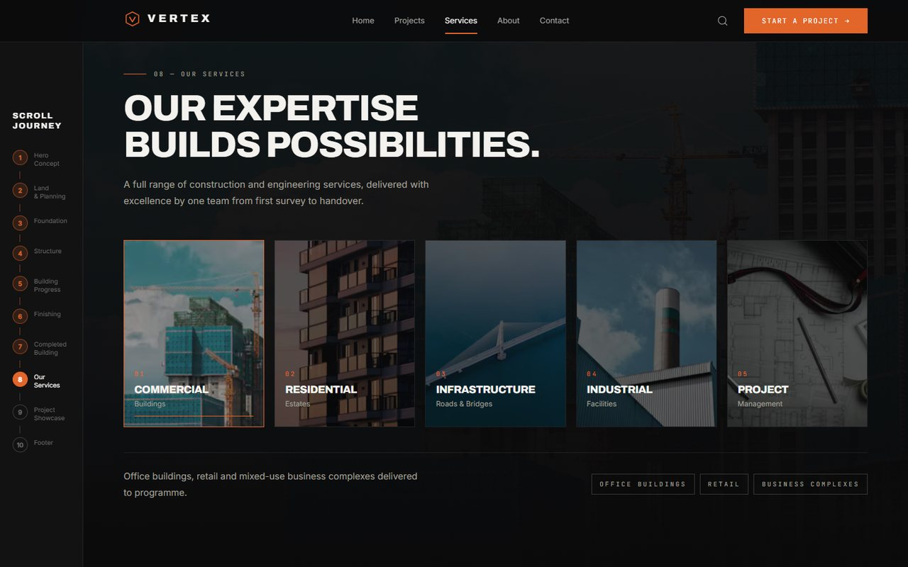
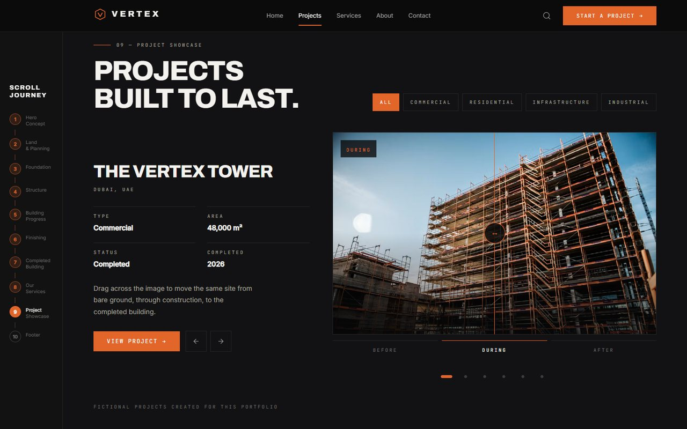

# VERTEX

A construction site you build by scrolling. React 19 + TypeScript + Vite, Tailwind CSS v4, Framer Motion, Lucide icons.

**Live:** https://vertex-iota-three.vercel.app



```bash
npm install
npm run dev      # http://localhost:5173
npm run build    # production build in dist/
npm run preview  # then: node scripts/verify-scroll.mjs
```

## The idea

The visitor arrives at a finished tower at sunset. As soon as they scroll, the camera pulls back off it and drops into empty land — and from there they build the thing they were just looking at. A numbered **scroll journey** down the left edge tracks where they are:

`Hero → Land & Planning → Foundation → Structure → Building Progress → Finishing → Completed Building → Our Services → Project Showcase → Footer`

The last stage returns to the same photograph the page opened with, so the journey closes where it began.

## The part that matters

Nothing here is a sequence of fades on a timer. Every stage derives its state from its own scroll position, so:

- stopping halfway through the foundation leaves the excavation halfway,
- the structure readout shows 50% when the scrollbar is halfway down that stage,
- and scrolling back up **un-builds** the tower.

Two pieces carry that:

- **`components/StageLayers.tsx`** — photographic layers whose opacity is a function of scroll. Layer *n* is fully opaque at position `n/(count-1)` and crossfades to its neighbours between.
- **`components/BuildingFrame.tsx`** — the tower as vector geometry. Each of the 18 floors owns a slice of the scroll range, so the frame genuinely assembles floor by floor rather than cutting between pictures.



In the land stage the survey drawing is laid over the photograph of the site — boundary, grid, floor plate in perspective, then the tower rising off the plan — while the planning panel beside it ticks through Site Survey, Planning, 3D Design and Approval on the same scroll value.




## Structure

- `src/sections/` — one file per stage, in scroll order: `Hero`, `Land`, `Foundation`, `Structure` (which contains the exploded view), `Progress`, `Finishing`, `Completion`, `Services`, `Showcase`, `FinalCTA`.
- `src/components/` — `Navbar`, `JourneyRail` (the numbered stage rail), `Intro` (title card), `StageLayers`, `BuildingFrame`, `Img`, `SplitLines`, `Reveal`, `Footer`.
- `src/data/content.ts` — all copy, imagery and project data. Edit content here, not in the sections.
- `src/hooks/useSectionProgress.ts` — the scroll hook every stage uses.
- Design tokens live in the `@theme` block of `src/index.css` — Tailwind v4, so there is no `tailwind.config.js`.

## Notes

`useSectionProgress` wraps `useScroll` in an identity `useTransform`. That is load-bearing: without it Framer hands scroll-linked values to the browser's native ScrollTimeline, and with multi-stop ranges the value desyncs from the actual scroll position — a stage reports 8% when you are halfway down it.

Motion respects `prefers-reduced-motion` through `MotionConfig reducedMotion="user"`; the intro title card is skipped entirely and scroll-linked transforms are gated separately, since `MotionConfig` does not cover those.

Nothing is gated on `pointer: fine`. Scroll-driven motion runs under a thumb exactly as it does under a mouse, and no information is hidden behind hover — the finishing-stage hotspots open on tap as well, and the service cards are a swipeable rail on a phone.

## Checks

Verified with headless Chrome against the built site:

- the structure readout hits 0 / 25 / 50 / 75 / 100% at exactly those fractions of its stage, and reverses when scrolled back;
- the same readout advances 14% → 50% → 86% on a 390px touch device, so the phone gets the build too;
- the land wireframe rises from 0 to 19 floors across its stage;
- the foundation depth gauge descends to −8.5 m and returns to grade;
- no horizontal overflow, clipped text, unloaded images, sub-10px text or console errors at 360, 390, 740 landscape, 768, 1024 and 1440.

## Content

VERTEX is a fictional practice. Every project, figure and contact detail is demonstration content, labelled as such on the page. Photography is served from the Unsplash CDN with a blurred placeholder behind each image; swap the photo ids in `content.ts` for a client's own photography before any real use.
